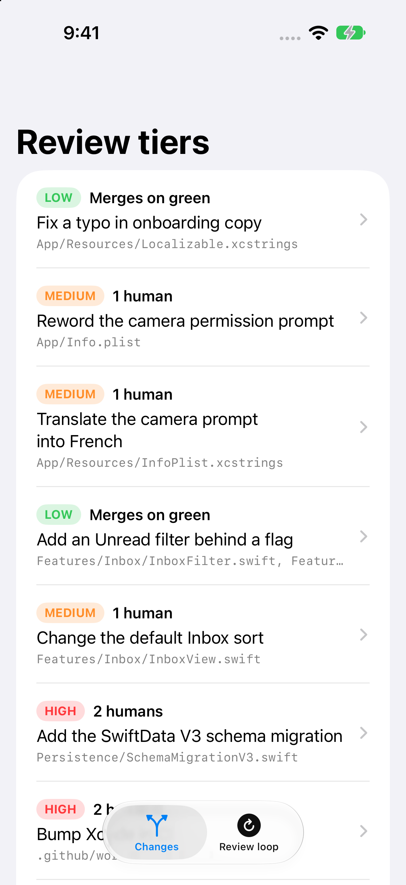
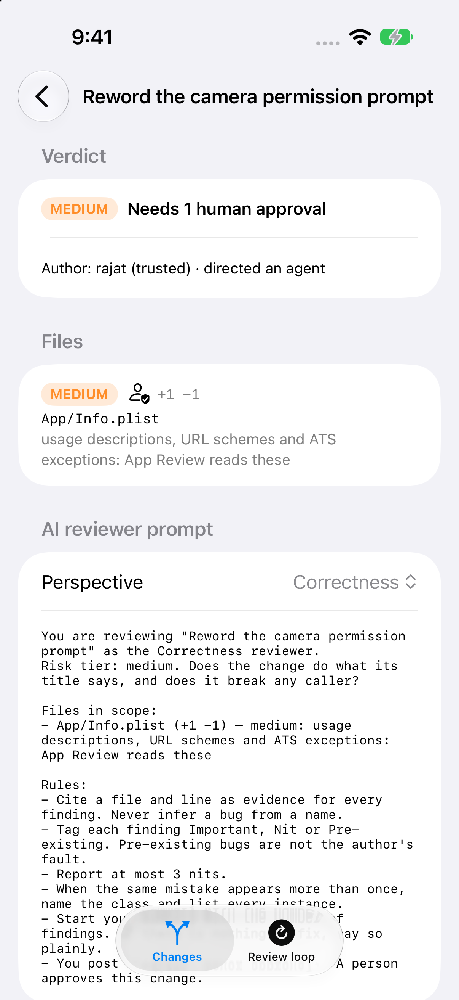
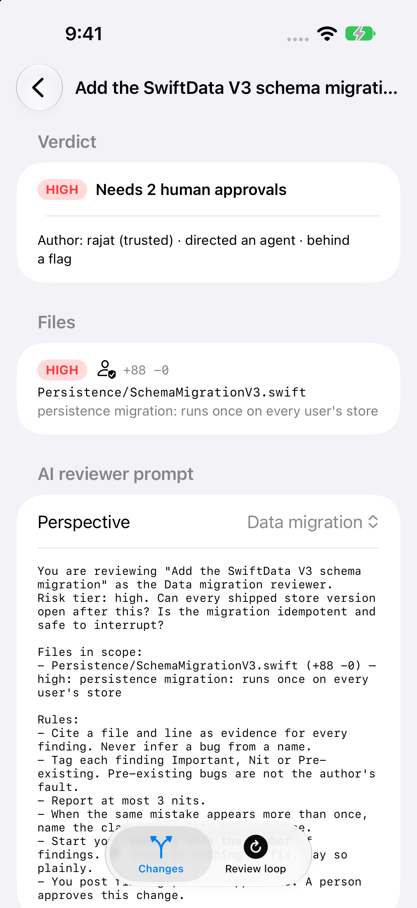
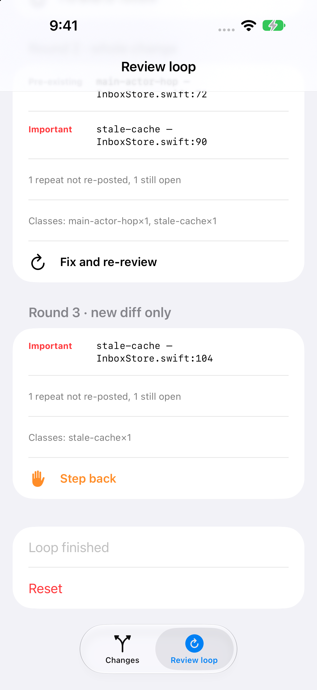

# ReviewTiers

**Risk-tier AI code review for an iOS repo: the change sets the tier, not the author.**

A small Swift library that classifies a pull request by the paths it touches, decides how many human approvals it needs, refuses to let an agent's approval fill a human slot, caps AI review loops, and builds focused reviewer prompts. It translates the policy in Anthropic's [How the Claude Code team does code review](https://claude.dev/blog/solving-code-review-at-anthropic/) (15 Oct 2026) into iOS terms.

Article: [AI Code Review Can Merge Copy Changes With Zero Humans. On iOS, Some Copy Gets You Rejected.](https://medium.com/@er.rajatlakhina/ai-code-review-can-merge-copy-changes-with-zero-humans-on-ios-some-copy-gets-you-rejected-3c31e2e05b74)

<p align="center">
  
  
  
  
</p>

## What's in it

| Type | What it does |
|---|---|
| `RiskPolicy` / `PathRule` | First-match path rules → tier (low 0 / medium 1 / high 2 humans). `alwaysHuman` paths need a person whatever the tier. `RiskPolicy.iOSDefault` ships an opinionated iOS list. |
| `Glob` | Dependency-free `**` / `*` / `?` path matcher. |
| `MergeGate` | Green CI + no open findings + enough **human** approvals **on the head commit**. Agent approvals never count. The author's own approval counts only on an agent-written PR they directed. Untrusted authors need someone else to approve. |
| `ReviewLoop` | Round cap (3, then "step back"), diff-only re-review after 2 rounds (file-level, when you pass `changedFiles`), no re-posted findings, but an Important finding the reviewer reports again stays open and blocks a pass (checked before the diff-only filter); findings grouped by class. |
| `ReviewerPrompt` | One perspective per AI pass (security, concurrency, accessibility, App Review, data migration, purchases) plus `REVIEW.md`-style house rules. |

Load-bearing decisions:

- **Copy isn't automatically low.** `Info.plist` (and custom-named `*Info.plist`), `InfoPlist.xcstrings` and legacy `InfoPlist.strings` hold permission purpose strings that App Review reads, so they're always-human. `InfoPlist.xcstrings` is matched *before* the generic `*.xcstrings` rule.
- **A flag only downgrades ordinary code.** Purely additive, flagged, medium files drop to low. A flag never downgrades an always-human path: it can't un-run a migration or revoke an entitlement.
- **The highest file sets the tier.**
- **The reviewer's own instructions are always-human.** `REVIEW.md`, `CLAUDE.md` and `AGENTS.md` are matched before the low-risk `*.md` rule.
- **Path rules are a floor.** An `@Model` property added to an ordinarily named file still migrates the store; pair the policy with a content-aware check.

```swift
let change = Change(id: "camera", title: "Reword the camera prompt",
                    author: Author("rajat", trusted: true),
                    files: [ChangedFile("App/Info.plist", added: 1, removed: 1)])
let verdict = RiskPolicy.iOSDefault.classify(change)
// verdict.tier == .medium, verdict.requiredHumanApprovals == 1

MergeGate.evaluate(verdict, change: change,
                   approvals: [Approval("claude", .agent, commit: "abc")],
                   headCommit: "abc", ciGreen: true, openFindings: 0)
// .blocked(["Needs 1 human approval on abc, has 0."])
```

## How to run it

1. `git clone https://github.com/rajatslakhina/review-risk-tiers-article-demo`
2. Open `Demo.xcodeproj` (the library is a local package in the same repo, no other setup).
3. Pick an iPhone simulator and press Run.

Library only: `swift build && swift test`.

`Scripts/simulator-screenshots.sh` builds the app for the simulator, launches it four times with launch arguments (`-change <id>`, `-lens last`, `-tab loop -autorun YES`), checks the process is still alive after each launch and saves the four screenshots above.

## Verification status

- `swift build -Xswiftc -warnings-as-errors`: clean. `swift test`: **37/37** passing (macOS, Xcode 27.2 / Swift 6.4.2).
- Simulator: built with `xcodebuild`, installed and launched on an iPhone 18 Pro (iOS 27.2) simulator four times; the app was still running after every launch. The four screenshots above are from that run.
- CI (`.github/workflows/ci.yml`) runs the same build, tests and simulator script.

## Not in scope

This doesn't read a real PR diff or call a model. It's the policy and the guard rails; wire `RiskPolicy.classify` into your CI with `git diff --numstat`, and send `ReviewerPrompt.build` to the reviewer you already use.

## Sources

- Addy Osmani, Morgan Westlee Lunt and Qing Wang, [How the Claude Code team does code review](https://claude.dev/blog/solving-code-review-at-anthropic/), Anthropic, 15 Oct 2026.
- Apple, [App Review Guidelines 5.1.1, Data Collection and Storage](https://developer.apple.com/app-store/review/guidelines/#data-collection-and-storage).

MIT licensed, see [LICENSE](LICENSE).
